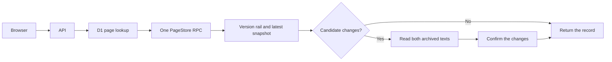

# CallHippo tracking and page latency

Reviewed on October 6, 2026. Code baseline: `aa15256`. Production evidence came from public API responses and archived sources. No production scans, data writes, or deployments were performed.

## Findings

The [CallHippo record](https://usepricelog.com/pages/callhippo.com) is not fully accurate.

| Finding                       | Evidence                                                                                                                                          | Cause                                                                                                                                           |
| ----------------------------- | ------------------------------------------------------------------------------------------------------------------------------------------------- | ----------------------------------------------------------------------------------------------------------------------------------------------- |
| Add-ons counted as plans      | The October 5 snapshot has 17 named offers. Seven are classified as add-ons. Branded Calling is an optional per-call service classified as usage. | Counts used the length of the offers array. Price type and plan identity were treated as the same thing.                                        |
| Annual prices labeled monthly | Starter has both €19 and €25 labeled monthly. The captured default is the yearly view.                                                            | Two billing labels share a hidden checkbox. The capture did not read its selected label. Jev then inferred billing from a per-month price line. |
| Unsupported plan additions    | Bronze, Silver and Platinum appear in a newly captured Pro Suite state. The older capture does not include that state.                            | The verifier accepted differences in capture coverage as evidence that offers were added.                                                       |
| Missing features              | Both published snapshots have no feature rows, although the archived text includes plan features.                                                 | The public records do not expose extraction output or review items. The exact extraction failure was not established from public evidence.      |
| Incomplete product coverage   | The older archive has two states. The latest archive has four.                                                                                    | Control labels, text limits, and the capture deadline constrain exploration.                                                                    |

The sources are the [September 28 archive](https://api.usepricelog.com/api/public/pages/00fa6e88-fc4c-41e5-ab56-776f0f611adf/runs/20f0c809-4334-411c-aee5-9ca06f8127ab/source) and the [October 5 archive](https://api.usepricelog.com/api/public/pages/00fa6e88-fc4c-41e5-ab56-776f0f611adf/runs/de42f7e5-1dca-4151-b380-de6121a9b934/source). The €9 to €10 AI Copilot price change is supported by both archives.

An absent extraction is not proof of an absent offer. A missing state also cannot prove an offer was removed.

## Page latency

One production browser visit produced these timings. They describe this visit, not a statistical benchmark.

| Request               | Start after navigation | Duration |      End |
| --------------------- | ---------------------: | -------: | -------: |
| `directory.getBySlug` |                 700 ms |   892 ms | 1,592 ms |
| `directory.version`   |               1,603 ms |   711 ms | 2,314 ms |
| Screenshot            |               2,334 ms |   707 ms | 3,041 ms |

The two data requests ran in sequence. Before the change, they also required separate D1 lookups and several Durable Object RPCs. The version service read both archived text files even when the snapshots had no candidate changes.

A Durable Object keeps a domain's state consistent. Requests still travel to the object's data center. [Cloudflare documents the resulting latency and object placement](https://developers.cloudflare.com/durable-objects/reference/data-location/).

Production scan duration was not measured. Browser capture, extraction, and Jev verification are separate from page-read latency.

## Local changes

- Read checkbox billing selections, use visible radio labels, permit longer product labels, start the exploration budget after consent, and restore the initial billing selection.
- Use captured billing metadata only when the quoted price exists in the stated capture block.
- Mark captures that reach time or text limits as partial. Archive that status and record an owner warning. Do not use absence in a partial capture to confirm additions or removals.
- Suppress offer additions or removals when the required UI state coverage differs between the archives. Require quoted price evidence on its own side of a change.
- Exclude add-ons from plan counts and the plan table. Keep their names and prices in a separate section. Preserve usage-priced plans, such as ElevenLabs Self Serve, and plans named only in verified feature rows. Use the same count rule in SQLite and the web app.
- Add a verification choice for optional add-ons charged per use. Existing snapshots retain their original classifications. CallHippo's Branded Calling needs a new evaluation to use this choice.
- Return the rail and latest published version through one Durable Object RPC and one browser API request. This also avoids choosing an older D1 projection as the latest version.
- Diff snapshots before reading archives. An empty candidate set requires no R2 reads.
- Update the pipeline fingerprint so new scans cannot reuse evaluations from the old implementation.

## Validation and limits

Regression tests cover changed capture coverage, partial captures, billing selections, optional usage add-ons, plan counts in real SQLite, the latest published version, foreign-page isolation, and archive reads for unchanged snapshots. All 237 distinct tests passed. Server and web type checks, lint, the web production build, and the whitespace check passed. The build retains a warning about the existing main client chunk exceeding 500 kB.

Real browser checks used the existing local app and its data. Polylane opened through the directory and changed to annual billing. DeepL showed Write Pro in the add-on section. The local data has no CallHippo record and no usable multi-version profile, so those paths were not verified locally.

A browser fixture reproduced the billing defect. The old script returned `unknown`; the corrected script returned `annual` and restored the checkbox selection. A live CallHippo capture with the corrected script collected eight states and detected annual billing. Two states exceeded the capture limits. This test did not run extraction or Jev and did not publish data.

Remaining work requires a fresh scan and owner diagnostics. Check why feature extraction publishes no rows, check the states that exceeded the capture limits, and inspect product scope. Offers are currently identified by plan name alone. Different products can reuse a plan name and merge into one offer. The next schema change should preserve product scope in offer identity.

The change verifier is conservative. It can withhold a real addition or removal when capture coverage is uncertain. This is preferable to publishing an unsupported change.

Deploy the server before the web app because the new web app expects the combined response. Then rescan CallHippo and compare the published record with every captured product and billing state. No production speed improvement or complete tracking fix has been established yet.

Browser proof is stored at `/private/tmp/pricelog-verification/pricelog-audit-1006/`.
