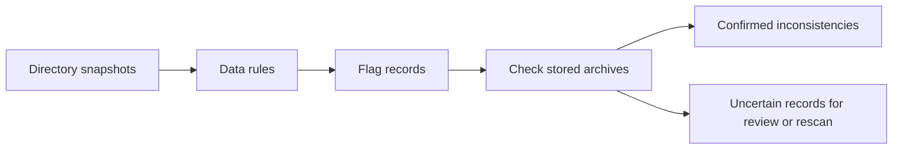

# Published pricing audit

The defects are not limited to CallHippo. A read-only audit checked all 106 public records, their latest archived sources, and 18 previous sources for records that publish changes. The network run took 58 seconds, with four records processed at a time. Evidence was collected on October 6, 2026, at 23:53–23:54 America/Bogota.

There are 105 collected snapshots and one unavailable snapshot, Clay. No archive requests failed. No vendor pages were opened, scans started, data changed, or deployments made.

## Automated findings

Counts overlap. The rules confirmed stored-data or display inconsistencies on 10 pages. Review rules flagged 62 pages; this is not a count of incorrect pages.

| Pattern                                                        | Pages | Meaning                                                                                                                                                                    |
| -------------------------------------------------------------- | ----: | -------------------------------------------------------------------------------------------------------------------------------------------------------------------------- |
| Named add-ons counted as plans                                 |     8 | Confirmed display/count defect relative to the stored price classifications; 25 add-on offers in total.                                                                    |
| Annual selection published as monthly                          |     2 | Confirmed from the exact source block containing the price. These are additional cases; CallHippo's hidden billing selection cannot be proved from its old metadata alone. |
| Published changes fail the stricter evidence check             |     6 | 18 change entries need review. Different state coverage or an offer already present on the supposedly absent side can invalidate an addition/removal claim.                |
| No feature rows                                                |    18 | Review only. Some API rate pages do not have plan feature tables.                                                                                                          |
| Names appear only in feature cells                             |    35 | Review plan identity and counts. Some are valid unpriced plans; others are table headings used as plan names.                                                              |
| Different prices under the same offer, kind, cycle, and period |    14 | Review only. Volume choices, promotions, audience, and product scope can explain this.                                                                                     |
| Billing control label names both cycles                        |     3 | Elai, Dify, and InVideo. The label alone cannot identify the selected cycle.                                                                                               |
| Placeholder offer name                                         |     1 | Autocalls groups named plan prices into an offer called `default`.                                                                                                         |

The eight add-on records are [CallHippo](https://usepricelog.com/pages/callhippo.com), [Lemlist](https://usepricelog.com/pages/lemlist.com), [Reply](https://usepricelog.com/pages/reply.io), [Apollo](https://usepricelog.com/pages/apollo.io), [Elai](https://usepricelog.com/pages/elai.io), [Tidio](https://usepricelog.com/pages/tidio.com), [SiteGPT](https://usepricelog.com/pages/sitegpt.ai), and [Chatbase](https://usepricelog.com/pages/chatbase.co).

The six change-review records are CallHippo, Intercom, Fireworks, OpenAI Developers, Lindy, and Fin. A rejected entry is not automatically false: the conservative verifier can also withhold a real change when the capture evidence is incomplete.

## Confirmed examples from the archives

- **D-ID:** Scale is $138.60 per month under annual billing, with a $1,663.20 annual total. Its published price says monthly. The snapshot's own `billing_view` also says annual. [Archived source](https://api.usepricelog.com/api/public/pages/fdf0a182-0b3a-4e04-a7bc-c819489f45d5/runs/74a43b7b-6fad-466f-b708-52c6a638ff92/source)
- **Regie:** The selected annual view shows Pro at $41 and Team at $125 per seat. Both published prices say monthly. The captured monthly view instead shows $49 and $150. [Archived source](https://api.usepricelog.com/api/public/pages/2e6fd131-7a52-4c76-95c0-4c3ed0059fa1/runs/cf3c3a42-288a-4186-b1cb-a67dd426d3e4/source)
- **Intercom:** Essential, Advanced, and Expert are reported as added. All three already exist in the earlier archive. [Earlier source](https://api.usepricelog.com/api/public/pages/a55c6f23-45b8-4978-b8db-aa8bbba61211/runs/8de587e0-7c86-46f7-83a1-2917a2419e66/source)
- **Fireworks:** Serverless Inference is reported as removed. It remains a named service in the current archive. Its commercial terms changed, but the service's absence is not supported. [Current source](https://api.usepricelog.com/api/public/pages/e02b2e12-4259-4d3c-b593-a6098f6b742d/runs/26632b59-8d43-499f-950e-df101909e251/source)
- **Cursor:** Pro, Pro+, and Ultra prices are grouped under Individual. Premium prices are grouped under Teams. Separate structured-data offers repeat some of these plan names. The capture contains the plan labels; extraction did not preserve them consistently. [Archived source](https://api.usepricelog.com/api/public/pages/c79fbc9d-d87f-429c-b229-224b9365ae6e/runs/a4ee3107-3b63-4f40-a79a-7725976248d4/source)
- **Autocalls:** Eight structured-data prices for four named plans are published under `default`, alongside other offers for those plans. This is an identity error, not eight different plans. [Archived source](https://api.usepricelog.com/api/public/pages/07d90487-509a-454e-a950-1d983d8229dd/runs/04afa9f0-9c03-4f13-b826-98f9055a4fe5/source)

These source checks confirmed additional errors in some of the automated review cases. The automated total of 10 does not include those manual confirmations.

## Repeat the audit

The new [audit script](/Users/jhonsfran/repos/usepricelog.com/scripts/audit-pricing.mjs) uses the public API. It does not require Cloudflare credentials.

```sh
# Fast snapshot checks: three directory requests for the current 106 records.
rtk proxy pnpm audit:pricing

# Verify billing and published changes against stored source evidence.
rtk proxy pnpm audit:pricing --archives
```

Both commands save a JSON report and evidence under `/private/tmp/pricelog-pricing-audit/`. Use `--output /absolute/path/report.json` to choose another location. `--archives --offline` checks saved evidence again without network requests. Failed archive checks are reported separately and make the command exit with status 1.



The fast mode is suitable for a routine quality check. Archive mode checks all latest public sources and checks a previous source only when the latest record publishes changes. Neither mode opens the original vendor sites.

The script preserves usage-priced plans and treats repeated prices as review cases. It does not assume that every zero-feature snapshot failed. The billing check requires the price quote in the stated archive block and rejects labels that name both monthly and annual billing.

This audit also found a case that required a local guard in the billing fix: a combined Monthly/Annually control label must not override a verified annual price. The guard and pipeline fingerprint were updated. The pricing fixes remain local and are not deployed.

## Limits and next work

Stored evidence can prove an internal inconsistency. It cannot prove that the capture includes every plan on the live site. The old archives do not record capture completeness, so a missing offer still needs a new capture or owner diagnostics.

The result covers the latest published records and 18 immediately preceding sources, not every historical version. There was no mismatch between the directory snapshots and the public version snapshots in this run.

Fix the shared extraction and plan-identity rules before rescanning the affected records. A per-page patch would leave the same failure available on another site. Priorities are billing, unsupported additions/removals, then product and plan identity. Feature extraction needs owner diagnostics to determine where feature rows are lost.

The complete machine report is [report.json](/private/tmp/pricelog-corpus-audit/report.json). Original network results and source evidence are under `/private/tmp/pricelog-corpus-audit/`. All 243 root regression tests passed, including six audit tests and the new billing regression. The server type check and lint also passed. The audit and its offline replay completed all 106 records without archive failures.
